# Discord, step by step

This page walks you through connecting the bridge to Discord for the first
time, one screen at a time. It takes about 15 minutes. You need:

- the bridge installed (`pipx install agent-letter-bridge`; see
  [`INSTALL.md`](../INSTALL.md), Steps 1–2);
- a Discord server where you can add bots. A server of your own works: in
  Discord, choose **+** at the bottom of the server list, then **Create My
  Own**;
- a terminal pane open next to your agent, inside cmux or tmux. The bridge
  rings that agent's pane when mail arrives.

You will copy one token out of Discord. It is a password. Paste it only into
the terminal where setup asks for it, and never into a chat, a document or a
screenshot.

---

## 1. Start setup in your terminal

```sh
alb --init --platform discord --root ~/.alb-discord
```

The first question is about where letters go:

```text
Does this agent already receive mail from other agents on
this machine - an inbox it already sweeps?
  y/N:
```

If you are not sure, press **Enter** (that means no). Setup then lists the
steps below and waits for the token. Leave the terminal where it is.

## 2. Make the application

Open <https://discord.com/developers/applications> in your browser and sign
in if it asks.

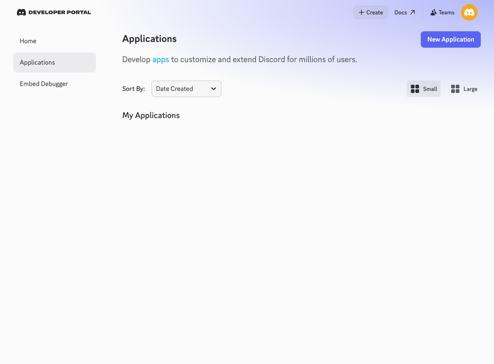

Choose **New Application**.

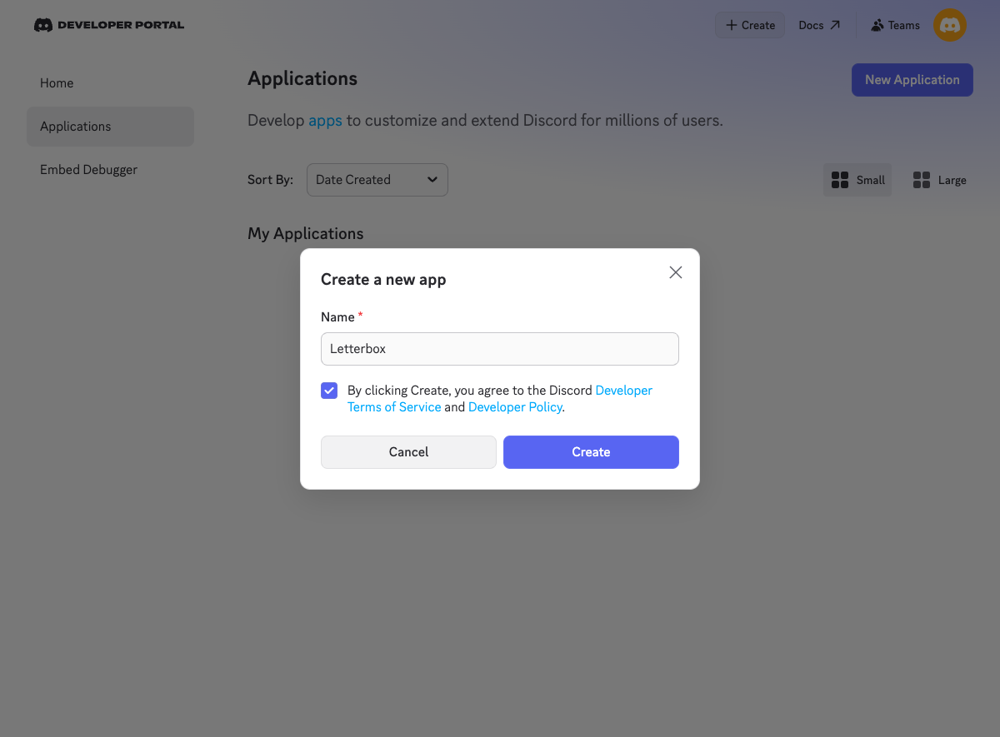

Give it a name, for example `Letterbox`, tick the box to agree to Discord's
terms, then **Create**.

## 3. Set up the bot and copy its token

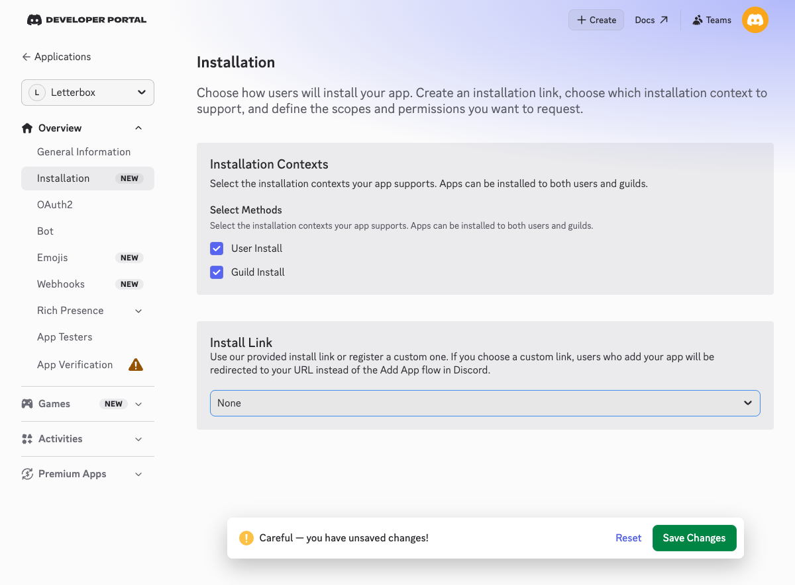

First, in the left-hand menu, choose **Installation**. Under **Install Link**,
choose **None**, then **Save Changes**. Discord will not let you make the bot
private (next step) while it still has an install link. If you skip this, it
says "Private application cannot have a default authorization link".

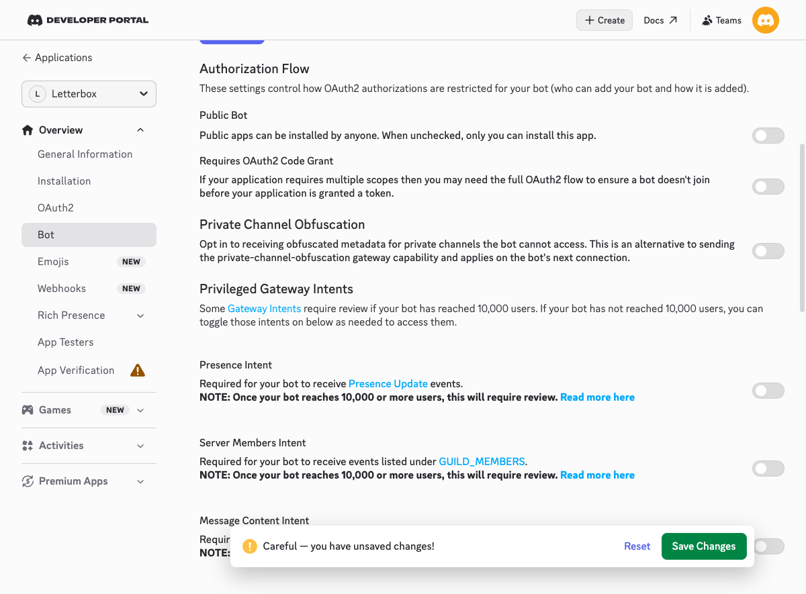

Then, in the left-hand menu, choose **Bot**. On that page:

1. Turn **Public Bot** off. Otherwise anyone who has your bot's link could
   add it to their own server.
2. Scroll to **Privileged Gateway Intents** and leave all three **off**. The
   bridge needs none of them, and with them off the bot cannot read channel
   messages that are not addressed to it.
3. Choose **Save Changes** if Discord offers it.

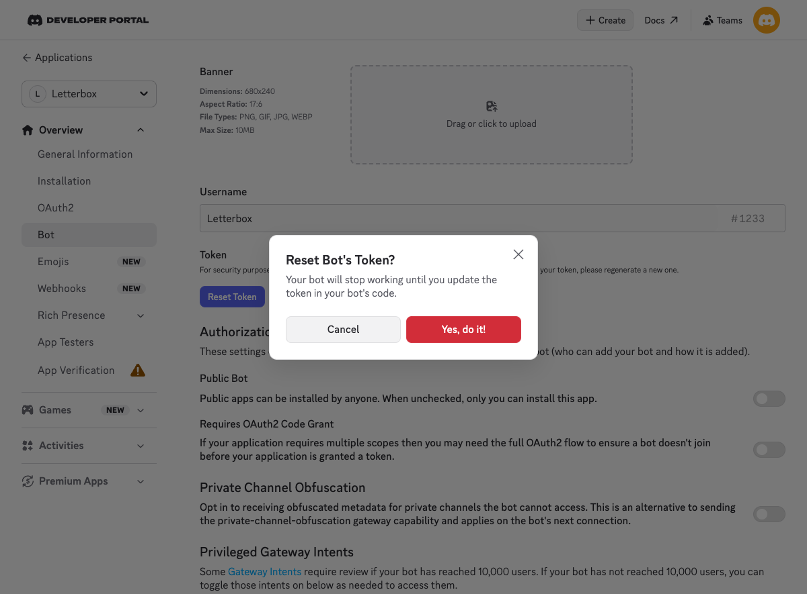

Scroll back up and choose **Reset Token**, then **Yes, do it!** Discord may
ask for your password or a code.

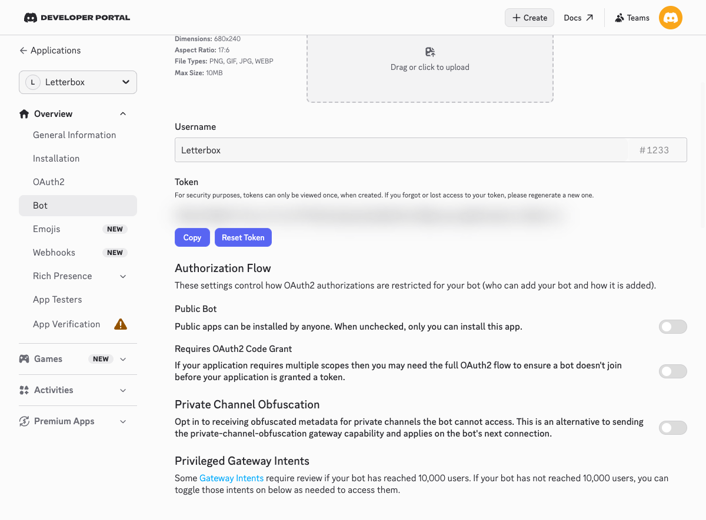

Discord shows the token **once**. Choose **Copy**, go back to the terminal,
and paste it at:

```text
  bot token (not echoed):
```

Nothing appears when you paste. That is on purpose: the token is a password,
so the terminal does not show it. Press **Enter**.

## 4. Add the bot to your server

Setup now prints a link made for your bot:

```text
4. Add the bot to your server. Open this link, pick the
   server, then Authorize:

   https://discord.com/oauth2/authorize?client_id=…&scope=bot&permissions=…
```

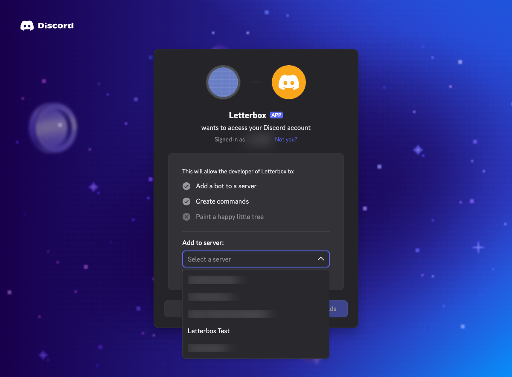

Open the link. Pick your server under **Add to server**, then **Continue**.

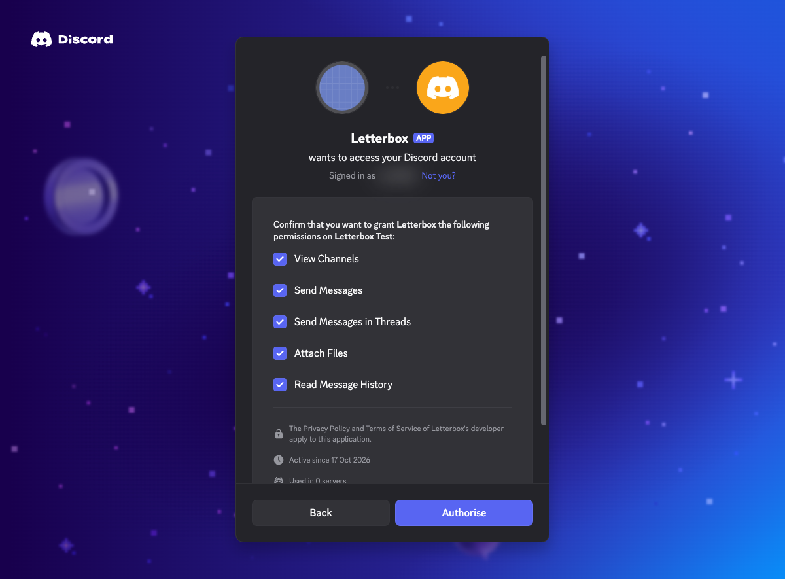

Discord lists what the bot may do: view channels, send messages, send
messages in threads, read message history and attach files. Nothing else.
Choose **Authorize**. Discord may then ask you to prove you are human; tick
the box.

## 5. Tell the bridge who you are

The bridge delivers a message only when it comes from someone on its
**allowlist**. It starts with nobody on it. Setup offers to find your entry:

```text
  read  - you paste your user ID; I check the token and open
          the DM channel with you. Nothing is sent.
  print - I tell you where to find them. I never touch the
          network.
  read or print:
```

Type `read` and press **Enter**. Setup asks for your user ID. To copy it:

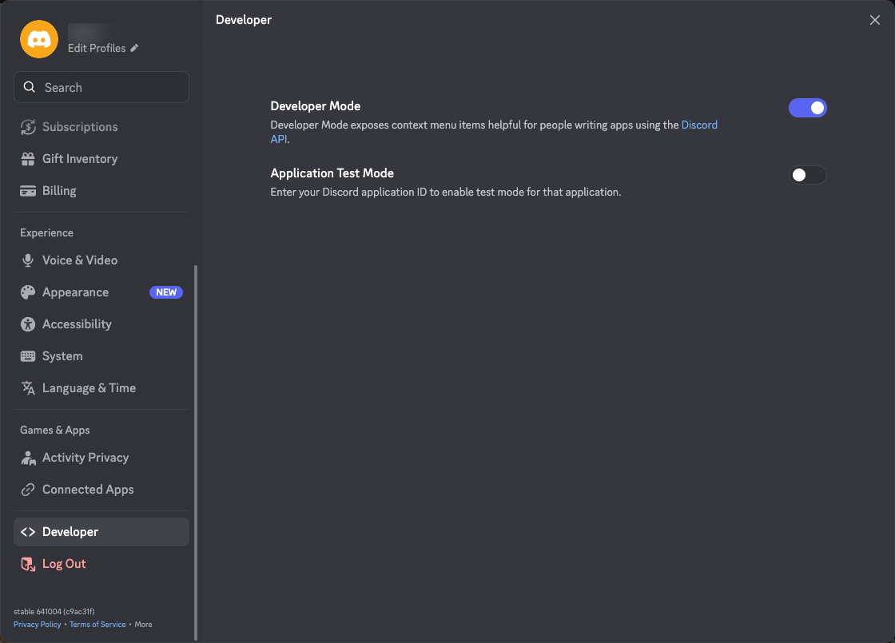

1. In Discord, open **User Settings** (the gear next to your name at the
   bottom left). Near the bottom of the list, choose **Developer** and turn
   on **Developer Mode**. (In older versions of Discord it is under
   **Advanced**.)

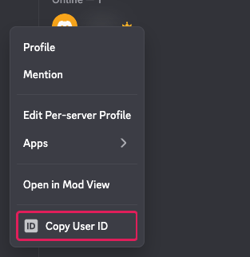

2. Close settings. In your server's member list (the people icon at the top
   right shows it), right-click your own name and choose **Copy User ID**.

Paste it into the terminal and press **Enter**. Setup checks the token, opens
the DM between you and the bot, and writes that pair, *this DM* and *you*,
as your allowlist entry.

## 6. Connect the bell

Setup lists the terminal panes it can see and asks for your agent's pane id:

```text
  your agent's pane id:
```

Paste the id of the pane your agent runs in. Setup will not guess: a bell in
the wrong pane lands in somebody else's session. In cmux it then offers to
start the bridge in its own pane; press **Enter** to start it. In tmux it
prints the command to run in a pane you leave open.

## 7. Test it

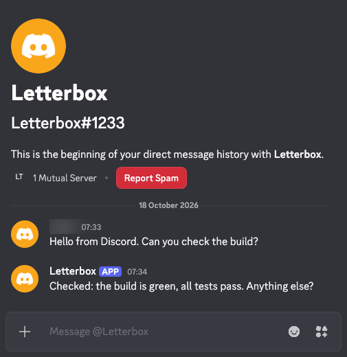

In Discord, click the bot in your server's member list, type a message in the
**Message @Letterbox** box on its card, and press **Enter**. That opens your
DM with the bot. Within a few seconds your agent's pane rings and the message
is a letter on disk. Ask your agent to reply; the reply appears in the same
DM.

If nothing arrives:

- `alb --config ~/.alb-discord/bridge.env --root ~/.alb-discord --status`
  says whether the bridge is running and whether your allowlist can deliver.
- `alb --doctor --root ~/.alb-discord` names the most likely reason.

Silence with no error is usually the allowlist doing its job. Check that the
message came from the DM and the person setup wrote down.

---

## Optional: use it in a channel

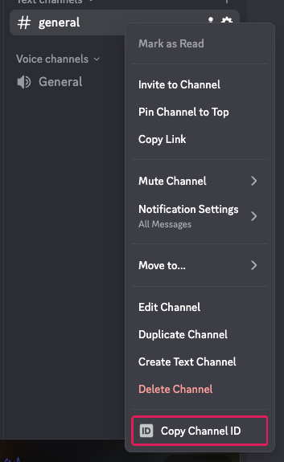

1. Right-click the channel and choose **Copy Channel ID** (Developer Mode
   must be on).
2. Add a second entry to `~/.alb-discord/allowlist.json` for that channel
   and you. Your user ID is the second half of the entry setup already
   wrote:

   ```json
   {"chats": ["<your DM>/<you>", "<the channel>/<you>"]}
   ```

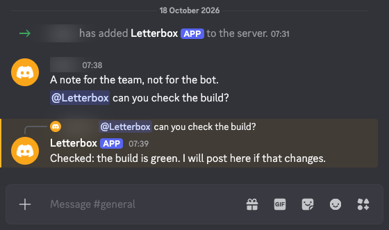

3. Mention the bot: `@Letterbox can you check the build?` The reply arrives
   as a reply to your message. Replying to the bot's message counts as
   mentioning it, so you can carry on the conversation that way.

One channel entry covers the threads in that channel. To let a teammate reach
the agent there, add their own pair for it.

## What to know

- **One bot serves one bridge.** For a second agent, make a second
  application the same way.
- **While the bridge is off**, messages wait in Discord's history and the
  bridge catches up when it starts again. The limits are in
  [`discord.md`](discord.md).
- **In a channel**, the bot reads only messages that mention it.
