# Slack, step by step

This page walks you through connecting the bridge to Slack for the first time,
one screen at a time. It takes about 15 minutes. You need:

- the bridge installed (`pipx install agent-letter-bridge`, see
  [`INSTALL.md`](../INSTALL.md) Steps 1–2);
- a Slack workspace where you are allowed to add apps. A free workspace of
  your own works. In a work workspace an admin may have to approve the app;
- a terminal pane open next to your agent, inside cmux or tmux. The bridge
  rings that agent's pane when mail arrives.

You will copy two tokens out of Slack. Each one is a password. Paste them only
into the terminal where setup asks for them, and never into a chat, a document
or a screenshot.

---

## 1. Start setup in your terminal

```sh
alb --init --platform slack --root ~/.alb-slack
```

The first question is about where letters go:

```text
Does this agent already receive mail from other agents on
this machine - an inbox it already sweeps?
  y/N:
```

If you are not sure, press **Enter** (that means no). Setup then prints a
block of text that starts with `{` and ends with `}`. That is the app's
**manifest**: it tells Slack exactly what the app is allowed to do. Select
all of it, from the first `{` to the last `}`, and copy it.

> Copy the manifest before you take any screenshot. A screenshot replaces
> what you copied.

Leave the terminal where it is. Setup waits for you.

## 2. Create the app in Slack

Open <https://api.slack.com/apps?new_app=1> in your browser and sign in to
Slack if it asks.

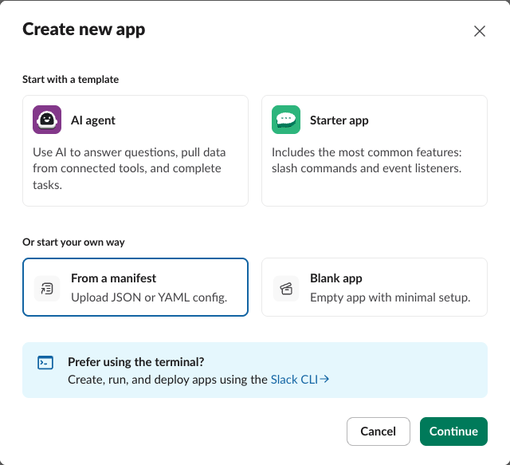

Under **Or start your own way**, choose **From a manifest**, then
**Continue**.

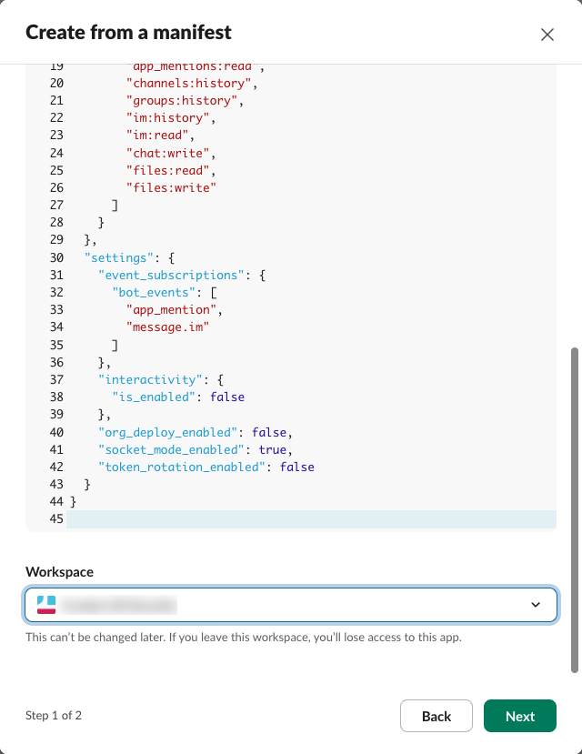

1. Make sure the **JSON** tab is selected. Click in the box, select
   everything already there, delete it, and paste the manifest you copied.
2. Under **Workspace**, pick the workspace the app should live in.
3. Choose **Next**.

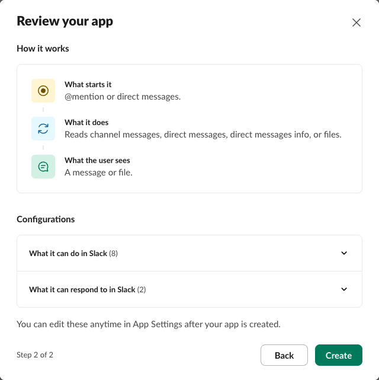

Slack shows a summary of what the app may do: **What it can do in Slack (8)**
and **What it can respond to in Slack (2)**. Choose **Create**.

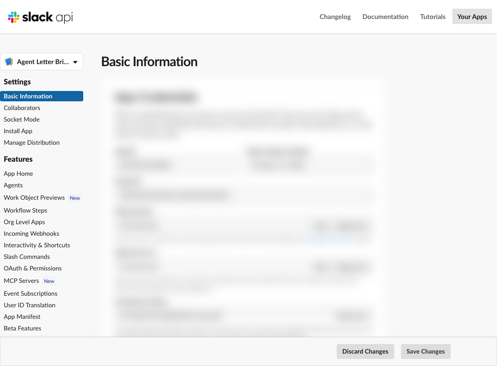

The app now exists. You are on its **Basic Information** page.

> **Do not screenshot or share the Basic Information page.** Further down it
> shows the app's secrets; they are blurred in the picture above. The bridge
> never needs them; it needs only the two tokens in the next steps.

## 3. Make the app-level token (starts `xapp-`)

This token lets the bridge open its connection to Slack.

On **Basic Information**, scroll down to **App-Level Tokens** and choose
**Generate Token and Scopes**.

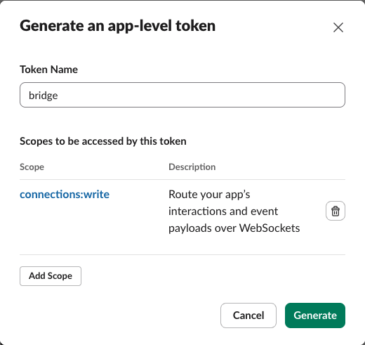

1. Give it any name, for example `bridge`.
2. Choose **Add Scope** and pick `connections:write`.
3. Choose **Generate**.

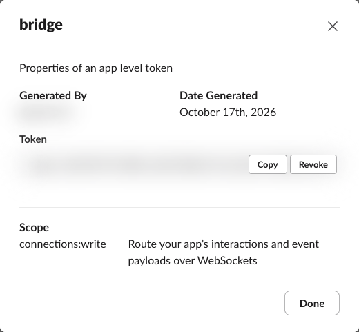

Choose **Copy**, go back to the terminal, and paste it at:

```text
  app-level token (not echoed):
```

Nothing appears when you paste. That is on purpose: the token is a password,
so the terminal does not show it. Press **Enter**.

Back in Slack, choose **Done**.

## 4. Install the app and copy the bot token (starts `xoxb-`)

This token lets the bridge read the messages sent to the app and post its
replies.

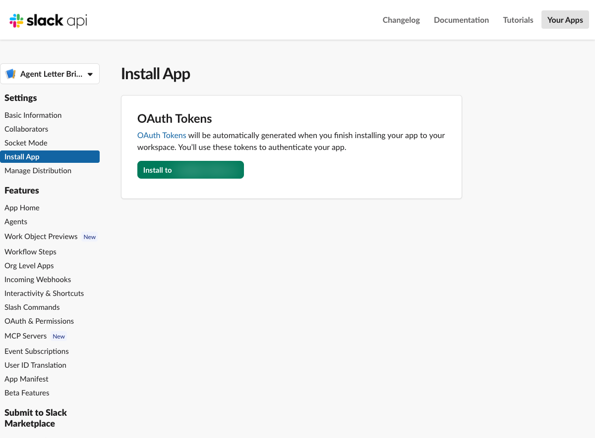

In the left-hand menu, choose **Install App**, then **Install to
&lt;your workspace&gt;**.

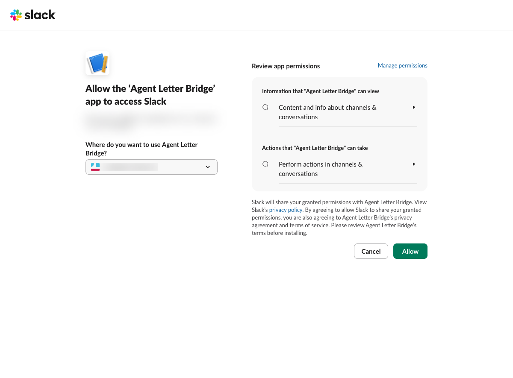

Slack asks you to allow the app. It sums up what the app can see and do in
your channels and conversations. Choose **Allow**.

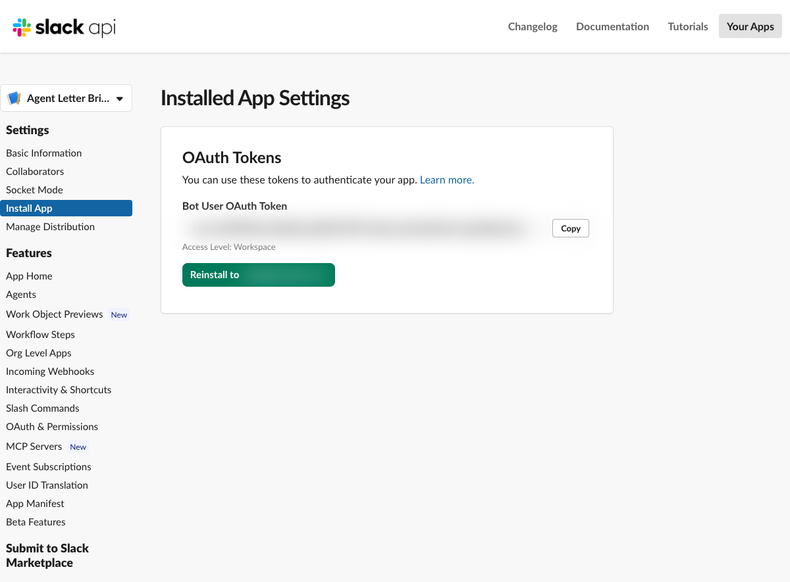

You are back on **Install App**, now showing the **Bot User OAuth Token**.
Choose **Copy**, go back to the terminal, and paste it at:

```text
  bot token (not echoed):
```

Again nothing appears. Press **Enter**.

## 5. Tell the bridge who you are

The bridge delivers a message only when it comes from someone on its
**allowlist**. It starts with nobody on it. Setup offers to find your entry:

```text
  read  - I check both tokens and list the bot's DMs, with read-
          only calls. Nothing is sent.
  print - I tell you where to find them. I never touch the
          network.
  read or print:
```

Type `read` and press **Enter**. Setup checks both tokens, then asks you to
send the app one message.

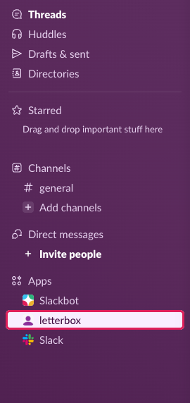

In Slack, find the app under **Apps** in the left-hand sidebar. The app is
named Agent Letter Bridge; its bot is named after the agent it reaches, such
as **letterbox-builder**, so two apps never look the same. A bridge set up
without a participant calls its bot **letterbox**, as in these screenshots.
If you do not see it, search Slack for `letterbox`.

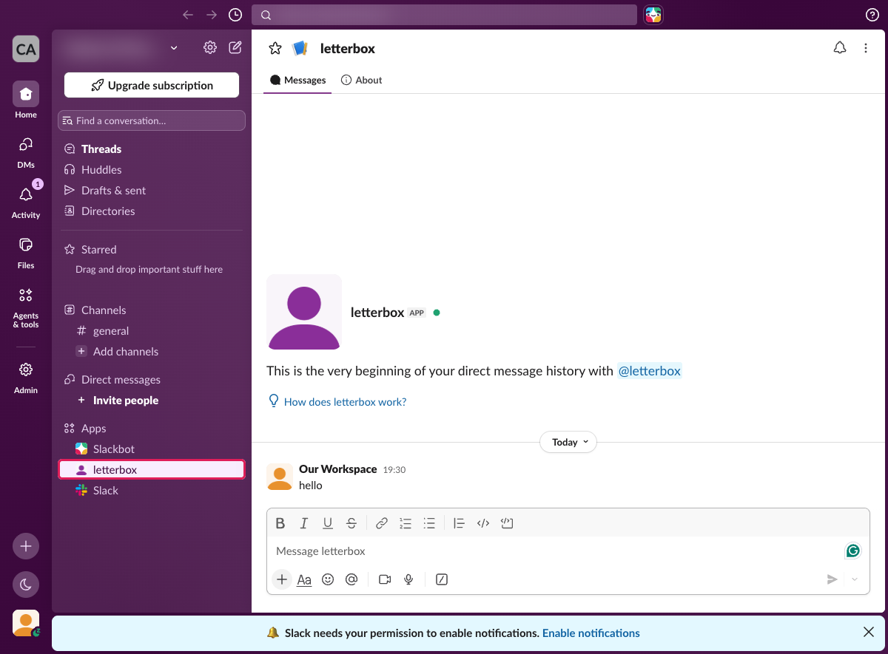

Send it any message, for example `hello`. Go back to the terminal and press
**Enter**. Setup lists what it found:

```text
  1) D0123ABCD/U0456EFGH  last message: 'hello'
  which one is you (number, or blank for none):
```

Type `1` and press **Enter**. That pair, *this DM* and *you*, is now your
allowlist entry.

## 6. Connect the bell

Setup lists the terminal panes it can see and asks for your agent's pane id:

```text
  your agent's pane id:
```

Paste the id of the pane your agent runs in. Setup will not guess: a bell in
the wrong pane lands in somebody else's session. Then it offers to start the
bridge in its own pane. Press **Enter** to start it.

## 7. Test it

In Slack, send the app another message. Within a few seconds your agent's
pane rings and the message is a letter on disk. Ask your agent to reply; the
reply appears in the same DM.

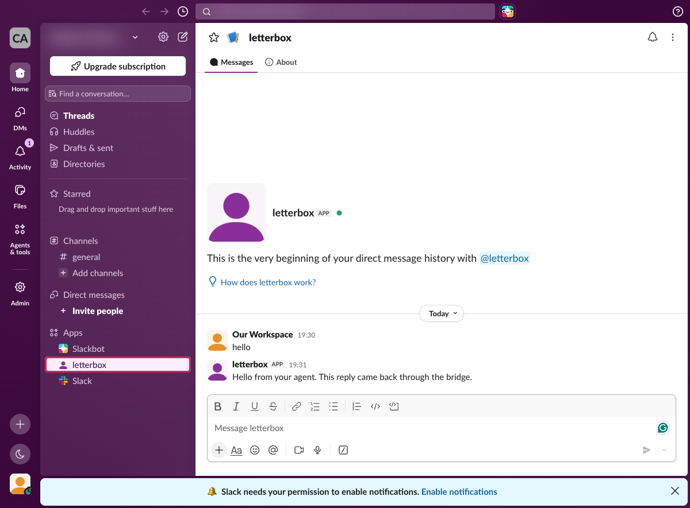

If nothing arrives:

- `alb --config ~/.alb-slack/bridge.env --root ~/.alb-slack --status` says
  whether the bridge is running and whether your allowlist can deliver.
- `alb --doctor --root ~/.alb-slack` names the most likely reason.

Silence with no error is usually the allowlist doing its job. Check that the
message came from the DM and the person setup wrote down.

---

## Optional: use it in a channel

In a channel, the app answers only messages that **@mention** it.

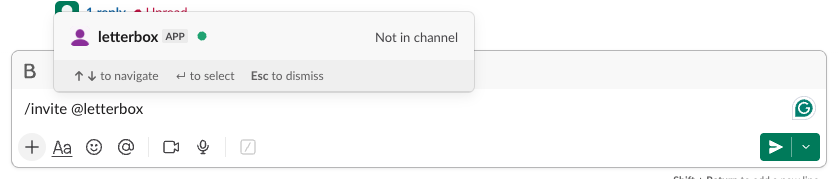

1. In the channel, type `/invite @` and your bot's name (for example
   `/invite @letterbox-builder`), pick the app from the list, and send it.
2. Find the channel's ID: choose the channel's name at the top. The ID
   (it starts `C`) is at the bottom of the **About** tab.

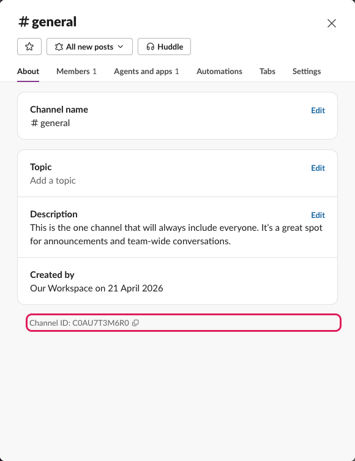

3. Add a second entry to `~/.alb-slack/allowlist.json` for that channel and
   you. Your member ID (starts `U`) is the second half of the entry setup
   already wrote:

   ```json
   {"chats": ["D0123ABCD/U0456EFGH", "C0789IJKL/U0456EFGH"]}
   ```

4. Mention the app: `@letterbox-builder can you check the build?` The reply arrives
   in a thread under your message.

To let a teammate reach the agent in that channel, add their own pair for it.

## What to know

- **One Slack app serves one bridge.** For a second agent, make a second app
  the same way. Slack's free plan allows 10 apps per workspace.
- **While the bridge is off**, messages wait in Slack; the bridge catches up
  when it starts again. The limits are in [`slack.md`](slack.md).
- **In a channel**, the app can read every message so that it can recover
  mentions it missed. Only messages that mention it become letters. Add it
  only to channels where that is acceptable.
